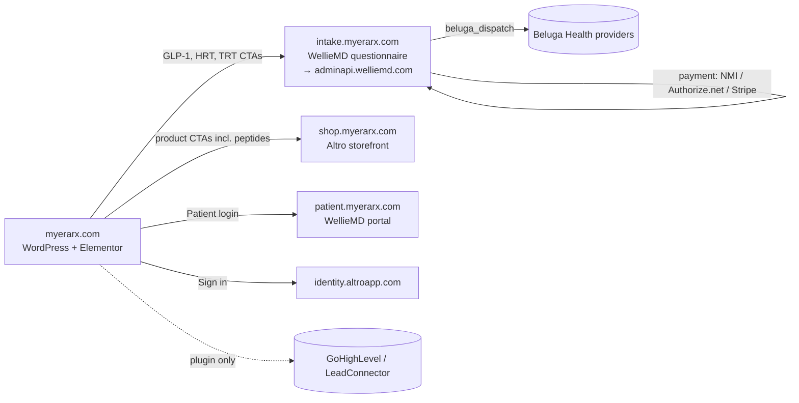
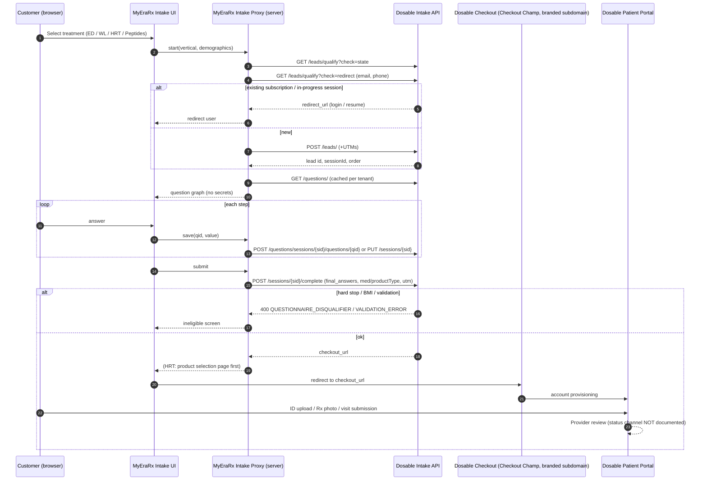
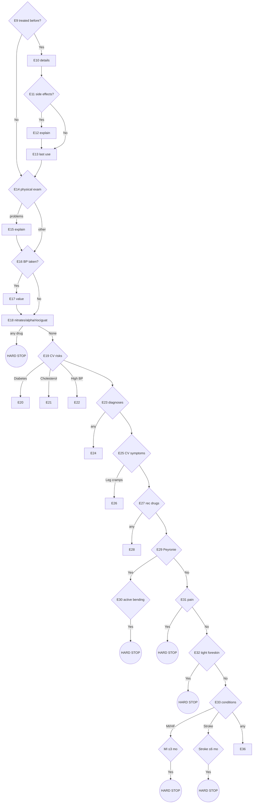
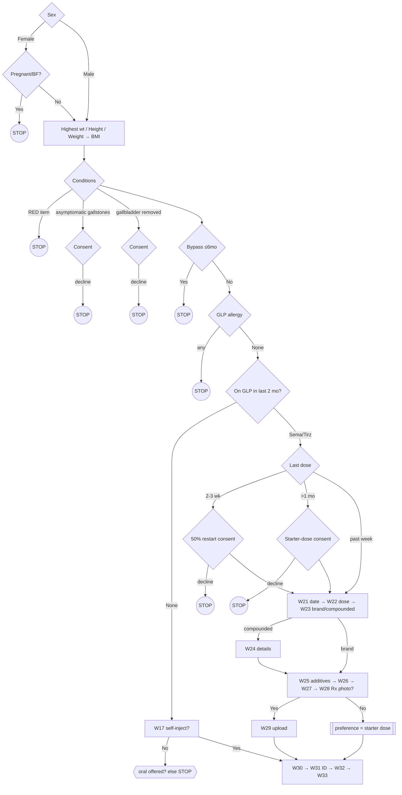
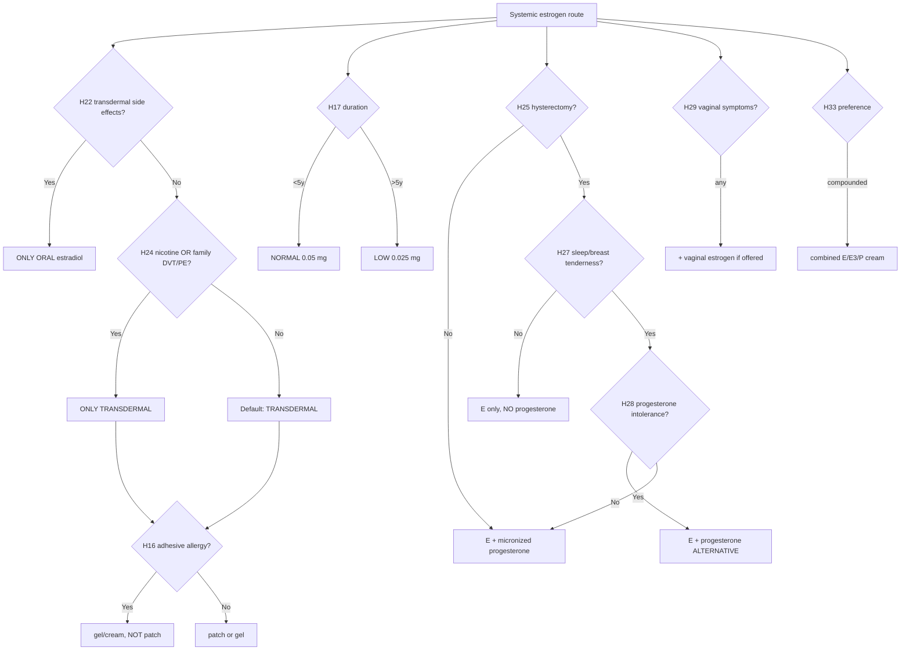
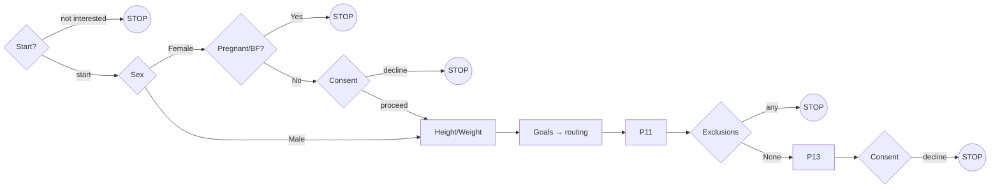
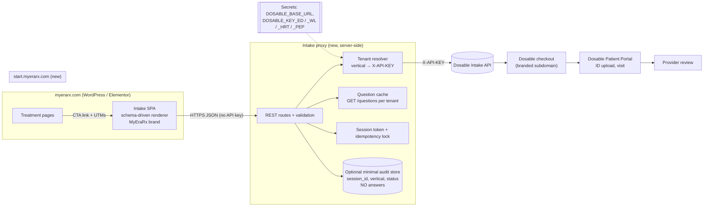

# MyEraRx Medical Intake Forms × Dosable API: Technical Analysis and Implementation Feasibility

**Prepared:** 17 Nov 2026 (revised to target the live **myerarx.com** website) · **Type:** investigation and planning only (nothing was changed on any system)

**Sources used:**
- **Live website `https://myerarx.com/`**, inspected on 17 Nov 2026:
  - the home page, `/treatments/` and every product page in `page-sitemap.xml`;
  - the HTML of each page;
  - the public front-end bundles of the linked subdomains (`intake.myerarx.com`, `shop.myerarx.com`, `patient.myerarx.com`).

  We did not log in or submit any form. We could not see the WordPress admin, the GoHighLevel account, the WellieMD admin or the Altro admin.
- **Dosable OpenAPI spec**, from `https://staging.intake.dosable.com/openapi.json` (the JSON that `/redoc` renders). It covers 20 operations and their schemas. We also read the public `GET /integrations/postman/verticals`.
- **The four `.docx` files** (Beluga Health templates), extracted with their **text colours**, because the colours carry meaning (§5.0).

**Not executed:** no authenticated Dosable call (no key yet), and no production request of any kind.

**Excluded:** the local `MyEra` code repository. It is the separate **My Era member companion app** (Expo, Express, Supabase), not the website. It plays no part in this integration.

Every finding below is tagged with one of these labels:
- **[FACT-SITE]**: observed on the live site or its subdomains.
- **[FACT-API]**: stated in the Dosable spec.
- **[FACT-DOC]**: stated in the questionnaire documents.
- **[ASSUMPTION]**: not verified.
- **[RECOMMENDATION]**: our proposal.

---

## 1. Executive Summary

1. **MyEraRx.com is a WordPress + Elementor Pro marketing site.** [FACT-SITE] It runs on nginx with a page cache, uses the theme "Finovate", and is maintained by the agency **KickStart Social**: there is a `kickstartsocial-website-helper` plugin and a footer credit. The site itself has **no checkout and no medical forms**. Every "Get started" button leaves WordPress for one of three systems:
   - **`intake.myerarx.com/visit/{slug}`**: a **WellieMD** questionnaire app (React SPA served by Express). It calls `adminapi.welliemd.com/api/v1`. Its code contains **Beluga Health** field mapping (`beluga_field_mapping`) and dispatch logic (`beluga_dispatch`). It takes payment through NMI, Authorize.net or Stripe.
   - **`shop.myerarx.com/rx/{uuid}`**: an **Altro** storefront (Next.js on Google Cloud; assets come from `lyvcare.com`). It sells à‑la‑carte prescription products, and its sign-in goes to `identity.altroapp.com`.
   - **`patient.myerarx.com`**: a **WellieMD patient portal** (S3/CloudFront). It calls `myerarx.api.welliemd.com`.
2. **Two of the four treatments already have a live intake. The other two don't:**

   | Treatment | Today on myerarx.com |
   |---|---|
   | Weight loss / GLP‑1 | **Already live**: WellieMD visits `glp-weight-loss`, `branded-glp-injectables`, `branded-glp-orals` |
   | Menopause / HRT | **Already live**: WellieMD visit `hormone-replacement-therapy` (from `/estradiol/`) |
   | ED | **No page and no intake.** The only sexual-health product is `/pt-141/`, sold through the Altro shop |
   | Peptides | **No intake.** Sermorelin, GHK‑Cu, PT‑141, NAD+, Glutathione and Lipo‑Mino are sold **through the Altro shop** |

   **So this project isn't greenfield.** Dosable would **replace** WellieMD for GLP‑1 and HRT, and **add** ED and Peptides. Whether that is what the client wants is **the most important open question** (L1).
3. **GoHighLevel is connected only lightly.** [FACT-SITE] The **LeadConnector WordPress plugin v4.0.7** is installed, with Elementor style overrides. The site's own forms are **Elementor forms** ("Free Guide", "Get in Touch", "Subscribe") plus a Mailchimp form. No GHL form, survey or funnel appears in any product's call to action. We could not see whether those Elementor forms sync to GHL (we have no admin access).
4. **Dosable is a headless intake engine.** [FACT-API] It stores the question definitions (`GET /questions/`, with `next_question_map`, `is_hard_stop` and `mapped_field`). It enforces hard stops, BMI and state rules at `POST /sessions/{id}/complete`. It returns a `checkout_url` for **its own hosted checkout** (Checkout Champ and Konnektive, on a branded subdomain). ID upload and visit submission then happen in **Dosable's Patient Portal**.
5. **Consequence: Dosable would bring a third checkout and a second patient portal.** MyEraRx already has WellieMD intake and checkout, the Altro shop checkout, and the WellieMD portal at `patient.myerarx.com`. Adding Dosable as documented means:
   - another checkout, on Checkout Champ;
   - another portal;
   - possibly a second route to Beluga, since the questionnaires are Beluga templates and WellieMD already dispatches to Beluga.

   The client must decide how these coexist, or which ones get retired.
6. **Dosable works with one vertical per tenant** (`ed`, `weightloss`, `hrt`, `peptides`), so MyEraRx most likely needs **four tenants and four API keys**. Dosable must confirm.
7. **Questionnaire completion is not medical approval.** In Dosable's flow the patient **pays first**. A provider then reviews the case after ID upload and visit submission. **No endpoint or webhook for the provider's decision is documented.**
8. **Recommendation:** build **custom, MyEraRx-branded intake flows** as a **stand-alone web app on a MyEraRx subdomain**, the same pattern the site already uses for `intake.myerarx.com`:
   - The app is **driven by Dosable `GET /questions/`**.
   - A small **server-side proxy** holds the Dosable keys.
   - Existing Elementor buttons simply link to it.

   We advise against both alternatives:
   - **Not GoHighLevel forms**: they can't drive Dosable's server-side, multi-step API, and HighLevel HIPAA is a paid add-on that is off by default.
   - **Not a WordPress plugin**: health data shouldn't pass through an agency-managed, page-cached WordPress install that runs Microsoft Clarity session recording.
9. **Blockers before development:**
   - the WellieMD replace-or-coexist decision (L1);
   - the Dosable tenant model and keys (D1, D3);
   - who controls DNS and WordPress, which means agency access (L2);
   - a clinical owner for the document ambiguities (L13);
   - the BAA position (L15, D14).

---

## 2. Understanding of Client Requirements

| # | Requirement (from brief) | Interpretation | Source of truth |
|---|---|---|---|
| R1 | Four questionnaires: ED, GLP‑1, HRT, Peptides | One intake per Dosable vertical (`ed`, `weightloss`, `hrt`, `peptides`). **GLP‑1 and HRT already have WellieMD intakes**; ED and Peptides don't | Word docs + Dosable tenant config |
| R2 | No redirect to an external questionnaire site | Today the questionnaire is already off WordPress, on `intake.myerarx.com` (WellieMD), but it carries the MyEraRx subdomain. We read the requirement as **MyEraRx-branded, on a MyEraRx domain, not a Dosable-branded page** | Client (confirm, L5) |
| R3 | Product or treatment selection opens the matching questionnaire | Change the Elementor CTA URLs on the treatment pages to the new intake: `treatment → vertical → Dosable tenant` | WordPress (agency) |
| R4 | Conditional questions, validation | Dosable `next_question_map` / `is_followup`, plus the colour legend in the documents | Dosable + docs |
| R5 | Eligibility logic | Hard stops are enforced **server-side by Dosable**. The UI mirrors them so ineligible customers can stop early | Dosable `is_hard_stop` |
| R6 | Eligible customers → checkout | `/complete` returns `checkout_url` (Dosable-hosted) | Dosable |
| R7 | Answers → Dosable for provider review | Answers are stored in the session's `startData`. Provider review begins after the visit is submitted in the portal | Dosable |
| Out of scope | CRM/email (GHL), App Store / Play Store | Not addressed | Karen |

---

## 3. Existing MyEraRx.com Architecture (live site)

### 3.1 Platform fingerprint [FACT-SITE]

| Component | Finding | Evidence |
|---|---|---|
| CMS | **WordPress** with **Elementor 4.4.1 + Elementor Pro**, theme **Finovate** (VamTam) | `meta generator`; `wp-content/themes/finovate`; plugins `elementor`, `elementor-pro`, `vamtam-elementor-integration-finovate` |
| Other plugins | `jeg-elementor-kit`, `essential-addons-for-elementor-lite`, `unlimited-elements-for-elementor-premium`, `health-calculators-addon`, `bmi-test-kickstart`, `bn_before_after_slider`, `ks-legal-elementor-widgets`, **`leadconnector` (v4.0.7)**, `kickstartsocial-website-helper` | asset URLs |
| Hosting | nginx with a server-side page cache (`x-proxy-cache: HIT`), PHP | response headers |
| Site management | Agency **KickStart Social** (helper plugin, footer link `kickstartsocial.co`) | HTML |
| Site forms | Elementor forms "Free Guide Form" (name, email, message), "Get in Touch Form" (name, email, phone, message), "Subscribe Form", plus a Jeg Kit Mailchimp form | `<form class="elementor-form">` |
| GoHighLevel | LeadConnector plugin CSS loaded. **No GHL form, survey, calendar or chat widget is embedded** in any page we fetched | asset scan |
| Analytics | **Microsoft Clarity** (session recording) on WordPress pages | script scan |
| Compliance pages | `/hipaa-notice/`, `/privacy-policy/`, `/terms-of-use/`, `/california-privacy-act/`, `/returns-refund-policy/`, LegitScript seal | footer links |
| Broken links | `/wegovy-injection/`, `/wegovy-pill/`, `/zepbound-injection/`, `/foundayo-pill/`, `/testosterone-hypo-spray/` return **404** | HTTP status |

### 3.2 External systems behind the CTAs [FACT-SITE]

| Subdomain | System | Tech | Backend it calls | Notes |
|---|---|---|---|---|
| `intake.myerarx.com/visit/{slug}` | **WellieMD** questionnaire ("WellieMD Questionnaire App") | React SPA, `x-powered-by: Express` | `https://adminapi.welliemd.com/api/v1` | Code includes `beluga_field_mapping`, `mapped_field`, `routing_profile`, `state_routing`, consent, `image_upload` (`beluga_ready`), BMI and `beluga_dispatch`. Payment SDKs: NMI Collect.js, Authorize.net Accept.js, Stripe. Smarty address API. CSP allows GTM, Facebook, TikTok and Google Ads pixels |
| `shop.myerarx.com/rx/{uuid}` | **Altro** storefront | Next.js on Google Frontend | Altro / Lyv Health | Sign-in through `identity.altroapp.com` (header "Sign in" link on the WordPress site) |
| `patient.myerarx.com` | **WellieMD** patient portal ("Patient Portal Dashboard") | Vite SPA on S3 + CloudFront | `https://myerarx.api.welliemd.com/api/v1/` | Also references `myerarxquestionnaire.welliemd.com` |

> **Security note (for the client to pass to WellieMD):** the public WellieMD intake bundle contains a hard-coded JWT-style token. It is visible to anyone who loads the page. We did not decode or use it, and it is not reproduced here. WellieMD should confirm it is a low-privilege public token.

### 3.3 Current page → CTA map for the four treatments [FACT-SITE]

| Requested treatment | Existing WordPress page(s) | Where the CTAs go today |
|---|---|---|
| **ED** | **None.** Closest is `/pt-141/` | `/pt-141/` → `shop.myerarx.com/rx/344c16cb-…` (Altro) |
| **Weight loss / GLP‑1** | `/personalized-glp-1/`, `/glp-1-gip/`, `/treatments/`, `/glp/`, `/metabolic-weight-management/` | `/personalized-glp-1/` and `/glp-1-gip/` → `intake.myerarx.com/visit/glp-weight-loss` **plus 6 Altro product links each**. `/treatments/` → `visit/branded-glp-injectables` and `visit/branded-glp-orals`. `/glp/` and `/metabolic-weight-management/` have no external CTA |
| **Menopause / HRT** | `/estradiol/`, `/progesterone-capsule/`, `/womens-testosterone-therapy/` | `/estradiol/` → `intake.myerarx.com/visit/hormone-replacement-therapy` + 2 Altro links. Progesterone and women's testosterone → Altro only |
| **Peptides** | `/sermorelin/`, `/ghk-cu/`, `/pt-141/`, `/nad-plus/`, `/glutathione/`, `/lipo-mino/` | **Altro shop links only** |
| (Other, out of scope) | TRT: home page, `/testosterone-cypionate/`, `/testosterone-cream/`, `/enclomiphene-capsule/`, `/hcg/`, `/anastrozole/`, `/low-dose-naltrexone/` | `visit/testosterone-replacement-therapy`, `visit/trt-support`, and Altro links |



### 3.4 Implications

- **Embedding is easy:** each CTA is an Elementor button URL. Pointing a treatment at a new intake is a **content change in WordPress**, which needs agency or admin access.
- **The subdomain pattern already exists.** A new intake at e.g. `start.myerarx.com` or `visit.myerarx.com`, or one that replaces `intake.myerarx.com`, keeps the experience on a MyEraRx domain. This needs **DNS control**: who owns it?
- **WordPress shouldn't carry PHI.** The site has a shared page cache, about 10 third-party plugins, agency administration and Clarity session recording. The questionnaire should run outside WordPress.
- **Overlap with WellieMD, Altro and Beluga** has to be settled before we design checkout and the portal (§10, L1).
- **What we could not inspect:** the WordPress admin, the GHL account (which workflows or pipelines exist), the WellieMD configuration, the Altro catalogue, and the existing Beluga contract.

---

## 4. Dosable API Technical Analysis

### 4.1 Environments and authentication [FACT-API]

**Environments:**
- Staging: `https://staging.intake.dosable.com/`
- Production: `https://intake.dosable.com/`
- Rate limit: 500 requests per minute per tenant.

**Tenant authentication:**
- Header `X-API-KEY` on **all** calls (security scheme `APIKeyHeader`).
- *"Your X-API-KEY must never be exposed in browser or client-side code"*. Store it in env vars or a secrets manager.

**Admin authentication:** `/auth/generate-key` uses HTTP Basic and is for Dosable admins only.

**Key lifecycle:**
- `POST /auth/rotate-key` keeps the previous key valid for **30 days**.
- `GET /auth/validate` returns `tenant_id` and `name` for the key.

**Key stages:**

| Key | What it can do |
|---|---|
| **Sandbox key** | Questions, answers, leads and sessions. **No product retrieval, no full checkout.** Sandbox question IDs **differ** from the tenant IDs. The blacklisted state is fixed to `TX`. Domain `intake.dosable.com/sandbox-tenant` |
| **Tenant staging key** | Full end-to-end flow. Delivered *"two weeks prior to go-live"* |
| **Production key** | Separate key |

**Go-live checklist:**
- Test `POST /leads/` and `/complete`.
- Confirm the `med` values.
- Verify Intake → Checkout → Portal → ID → Visit.
- Submit **2 Master Submission IDs**: one with all conditional follow-ups and one with none.

### 4.2 Endpoint inventory (relevant to our use case)

| # | Method & path | Purpose | Key inputs | Key outputs | Depends on |
|---|---|---|---|---|---|
| 1 | `GET /blacklist-states` | Declined states for the tenant | – | `{states:[…]}` | – |
| 2 | `GET /leads/qualify?check=state&lead_state=XX` | State eligibility | `lead_state` | `eligible_state` | – |
| 3 | `GET /leads/qualify?check=redirect&email&phone[&responder_uuid&med&couponCode]` | Existing subscription → **login**. In-progress session → **resume**. Otherwise none | email, phone | `redirect_required`, `redirect_type` (`login`/`resume`), `redirect_url` | – |
| 4 | `POST /leads/` | Create the patient lead **and** an order/session | `UserCreate` (§4.3) | `UserResponse` + `order`, `sessionId`. **Or** 200 redirect payload | 1–3 recommended |
| 5 | `GET /leads/{user_id}` / `PUT /leads/{user_id}` | Read / update the lead | `UserUpdate` | `UserResponse` | 4 |
| 6 | `POST /sessions/` | Create a session (standard or **checkout-first** flow). Accepts `session_id`, `checkoutFirst`, `external_order_id`, `initial_data`, `user_id`, `utm_*` | | `session_id`, `order`, `missing_lead_fields` | optional; see Q-D5 |
| 7 | `GET /questions/` | **All questions for the tenant**, with branching and hard-stop metadata | – | `QuestionResponse[]` | – |
| 8 | `GET /questions/{question_id}` | One question | | `QuestionResponse` | – |
| 9 | `POST /questions/sessions/{session_id}/questions/{question_id}` | Save one answer | `{ "<qid>": {value, question} }` | `order.startData` | 4/6, 7 |
| 10 | `GET /questions/sessions/{session_id}/questions/{question_id}` | Read one answer | | `{order_id, question_id, value, question, update_metadata_source}` | 9 |
| 11 | `PUT /sessions/{session_id}` | **Bulk, atomic** answer upsert | `{ "<qid>": {value, question}, … }` | `updated_questions`, `order` | 4/6, 7 |
| 12 | `POST /sessions/{session_id}/complete` | Finalise: merge `final_answers`, run hard stops, BMI and product validation, return checkout URL | `final_answers`, `med`, `productType` (WL), `couponCode`, `utm_*`, `cc_custom_*`/`custom_*` | `{completed, checkout_url}` or `{completed, thanks_url, flow_type}` (checkout-first) | 9/11 |
| 13 | `GET /sessions/{session_id}` / `GET /sessions/?completed=` | Session + lead + order + `startData` | | `order.status`, `selectedProduct` | 4/6 |
| 14 | `GET /products/` | Tenant catalogue: `medId`, `price`, `category`, `campaign_product_id` (HRT mapping) | – | product array | **not in sandbox** |
| 15 | `GET /orders/?session_id=` | Order snapshot | | `status` 0/1/2 | 4 |

**Not documented anywhere in the spec:**
- webhooks or callbacks;
- provider decision or approval status;
- prescription status;
- file or image upload;
- an idempotency key;
- delete or withdraw session;
- questionnaire *versions* per vertical. `version_id` exists on questions, but there is no endpoint for it.

### 4.3 Schemas (actual)

**`UserCreate`** (`POST /leads/`). No field is marked `required` in the schema. The prose says first and last name are *"required for lead processing"*.

| Field | Type | Rule |
|---|---|---|
| `tenant_id` | int | must match the key's tenant |
| `email` | string (email) | dedupe key; `+` aliases allowed |
| `phone` | string | 10 digits, normalised; dedupe key |
| `first_name`, `last_name` (or `name`) | string | required (prose) |
| `birthday` | string | **`MM/DD/YYYY`** strict |
| `gender` | string | e.g. `"Male"`. Allowed values are **not enumerated** |
| `lead_state` | string | 2-letter US code, checked against the blacklist |
| `zip_code` | string | exactly 5 digits |
| `street`, `city` | string | present in the schema, undocumented in prose |
| `sessionId` | string | UUID. Auto-generated if omitted |
| `role`, `crosscheck`, `verification`, `id_verification_*`, `user_id`, `password` | various | not needed for intake. **Do not send `password`** |

**`QuestionResponse`**:
- Required: `id`, `version_id`, `mapped_field`, `next_question_map`, `next_question_id`, `prev_question_id`, `is_hard_stop`, `hard_stop_response`, `hard_stop_message`, `title`, `description`, `type`, `is_followup`, `tenant_id`, `category_final_question`.
- Optional: `options[]` of `{id, question_id, option_text}`.
- `type` ∈ `radio | checkbox | text | textarea | select`. **There is no `date`, `number`, `file`, `consent` or `info` type.**

**Answer object:** `{ "<question_id>": { "value": string | string[], "question": "<title>" } }`. Radio, select and text take a string. Checkbox takes an array. Choice values **must equal `option_text` exactly**. Example error: *"Invalid answer … Valid options are: ['Yes','No']"*.

**Concrete example (from the spec), saving an answer:**

```http
POST /questions/sessions/9d2f…/questions/57
X-API-KEY: ••••• (server-side only)
Content-Type: application/json

{ "57": { "value": ["Other medicines containing nitrates"],
          "question": "Do you take any of the following medicines? Select all that apply." } }
```

**Example: completing a weight-loss session:**

```json
{ "final_answers": { "3936": { "value": "I consent", "question": "Consent (GLP-1 and GLP-1/GIP)" } },
  "med": ["QynInZ5DAOcQqnxiF1VWnAuoclyn6gry"],
  "utm_source": "google" }
```

**Hard-stop response (400):**

```json
{ "error": { "code": "QUESTIONNAIRE_DISQUALIFIER",
  "message": "Based on your response, we cannot proceed with the medication at this time.",
  "details": { "question_id": "3205", "question_title": "Are you currently pregnant…", "hard_stop_message": "…" } } }
```

### 4.4 Vertical-specific rules [FACT-API]

- **Weight loss:**
  - `/complete` **requires** either `productType` (`semaglutide` | `tirzepatide`) **or** `med`. `med` must be an introductory product with category `weightloss0`.
  - If you sell 3‑month supplies or several price points, **`med` is mandatory**.
  - BMI is validated automatically: **≥ 25 for new patients** (medication answer = "None of these") and **≥ 20 for existing patients**.
  - Height must use the format `5'10"`. Weight must be numeric, with no units.
- **HRT:**
  - `med` is optional. Supply lengths are `_monthly`, `_3month`, `_6month` and `_6month_3ship`.
  - `checkout_url` returns `products=2:1;4:1;…`.
  - **The brand must build a product-selection page.** It maps `products` IDs to `/products` by `campaign_product_id` and lets the user de-select items before redirecting to checkout.
- **ED:** `med` and `couponCode` are optional.
- **Peptides:** no vertical-specific rules are documented. It is listed as a vertical, with `example_id_base: 7500000`.

### 4.5 Required API workflow (documented)



| Investigation point | Status |
|---|---|
| Identify/create patient | **Documented**: `POST /leads/` (+ qualify) |
| Identify/create treatment request | **Partly**: a lead auto-creates an order and session. `POST /sessions/` also exists. The correct ordering is **not confirmed** |
| Retrieve questionnaire definitions | **Documented**: `GET /questions/` (per tenant) |
| Submit responses | **Documented**: per-question save, bulk `PUT`, `/complete` |
| Retrieve submission status | **Partly**: `GET /sessions/{id}`, `GET /orders/` (status 0/1/2) |
| Provider review / approval status | **Not documented** |

### 4.6 Inconsistencies in Dosable's own docs (raise with Dosable)

| # | Inconsistency | Where |
|---|---|---|
| I1 | The answer endpoint is `/sessions/{id}/questions/{qid}` in the Quickstart, but `/questions/sessions/{id}/questions/{qid}` in the OpenAPI paths | Quickstart vs `paths` |
| I2 | A duplicate lead returns **409 `DUPLICATE_LEAD`** (Quickstart) vs **200 with the existing lead** ("no 409", plus *"TODO: Revisit this and communicate to clients"*) | `POST /leads/` description |
| I3 | Weight-loss `/complete` examples use `final_question`. Every other example uses `final_answers` | `/complete` description |
| I4 | Lead body uses `session_id` (Quickstart) vs `sessionId` (schema) | `UserCreate` |
| I5 | Success is documented as `201`, but the OpenAPI response is `200` | several |
| I6 | The error envelope varies: `{detail:{…}}`, `{error:{…}}` and top-level `{error, error_code,…}` | throughout |
| I7 | The spec says `/products/` returns `id/name/…`, but the Quickstart and HRT flow rely on `medId` and `campaign_product_id` | `/products/` |
| I8 | Lead creation *"Sends lead data to marketing automation platforms (Klaviyo, Omnisend, SendGrid, etc.)"*. This is a data-flow and consent concern | `POST /leads/` |

The client must handle **all** error envelope shapes defensively.

---

## 5. ED Questionnaire Analysis

### 5.0 How to read the Word documents (applies to all four) [FACT-DOC]

All four are **Beluga Health** templates, marked *"PRIVATE AND CONFIDENTIAL"*. Their legend is colour-coded, and we extracted the colours programmatically:

| Colour | Meaning (verbatim intent) | Implementation consequence |
|---|---|---|
| BLACK | Required question, sent in Q/A | Always shown and required |
| BLUE | Conditional; show only when triggered; sent in Q/A | `is_followup` / `next_question_map`. Whether it is required once shown is **not specified** |
| PURPLE | Mapped to *named fields* "shown in the API docs"; **NOT** in Q/A | Named fields: `sex`, `medicalConditions`, `selfReportedMeds`, `allergies`. **None of these names exist in the Dosable spec.** They are probably Beluga's visit API, reachable through Dosable's `mapped_field` (**Not confirmed**) |
| RED | **Fully disqualifying answer** | Must equal Dosable `is_hard_stop` + `hard_stop_response` |
| GREEN BG `{…}` | Implementation note, not shown | Developer instruction |
| PINK | Product routing, not shown; *"should correspond to `patientPreference` in the visit creation payload"* | **`patientPreference` is a Beluga field, not a Dosable one.** On the Dosable side the closest equivalent is `med` / `productType` at `/complete` (**Not confirmed**) |

**Key consequence:** the documents describe the integration as **Beluga's** visit API (named fields, `patientPreference`). Dosable sits between MyEraRx and Beluga. We must confirm with Dosable that each vertical's Dosable template matches these documents, including the red and pink rules.

**Supporting evidence from the live site** [FACT-SITE]: the current WellieMD intake on `intake.myerarx.com` already implements this Beluga model. Its public code maps answers through `beluga_field_mapping` / `mapped_field` (e.g. `sex`, `date_of_birth`, `state`), uses `routing` scopes, and has `consent` and `image_upload` question types. That confirms the PURPLE and PINK conventions are Beluga visit-payload concepts. In Dosable they are probably represented by `QuestionResponse.mapped_field` (still **Not confirmed**).

> The "Required/Optional" column below follows the legend: Black = Required. Blue = "Cond." (shown only when triggered; whether it is required once shown is **not specified**). Purple = Required named field.

### 5.A Overview

- **Purpose:** ED telehealth visit (PDE5i ± Trimix).
- **Visit specifics:** follow-up every 12 months; labs not required.
- **Sections:**
  1. Demographics and named fields
  2. ED history
  3. Prior treatment
  4. Physical exam and BP
  5. Contraindicated meds
  6. Cardiovascular (CV) risk and symptoms
  7. Diagnoses
  8. Recreational drugs
  9. Penile anatomy
  10. Serious conditions
  11. Notes
  12. Consent (one of two variants)
  13. ID upload
- **Size:** **39 patient-facing items**, including 2 consent variants of which one is shown, and the ID upload.
- **Types:** radio, checkbox, free text, image upload, long-form consent.

### 5.B Question breakdown

| # | Question | Input | Options | Req. | Conditional logic | Eligibility impact |
|---|---|---|---|---|---|---|
| E1 | Sex assigned at birth | radio | Male / Female | Req (PURPLE → `sex`) | – | **Female = RED** |
| E2 | Height (ft/in) | text | Free text | Req | – | Not specified |
| E3 | Weight (lb) | text | Free text | Req | – | Not specified |
| E4 | Current medical conditions | textarea | Free text | Req (PURPLE → `medicalConditions`) | – | Clinical review |
| E5 | Current medications + doses | textarea | Free text | Req (PURPLE → `selfReportedMeds`) | – | Clinical review |
| E6 | Known allergies | textarea | Free text | Req (PURPLE → `allergies`) | – | Clinical review |
| E7 | Problem getting/maintaining erection? | radio | Every time / >half / occasion / rarely / **I never have a problem…** | Req | – | **"I never have a problem" = RED** |
| E8 | Do you get erections… | radio? (not specified) | When you wake up / Other times / Neither | Req | – | Not specified |
| E9 | Formally treated for ED / tried meds? | radio | Yes / No | Req | Yes → E10–E13; No → skip | – |
| E10 | Treatment, dosage, effectiveness | textarea | Free text | Cond. | shown if E9=Yes | – |
| E11 | Side effects from ED treatments? | radio | No, never / Yes | Cond. | Yes → E12 | – |
| E12 | Explain side effects | textarea | Free text | Cond. | E11=Yes | – |
| E13 | How long ago last use? | text | Free text | Cond. | E9=Yes (implied) | – |
| E14 | Physical exam in past 5 yrs? | radio | Yes good health / Yes but problems / No | Req | "problems" → E15 | – |
| E15 | Explain exam issues | textarea | Free text | Cond. | E14=problems | – |
| E16 | BP taken in past year? | radio | Yes / No, will get new | Req | Yes → E17 | – |
| E17 | BP value (e.g. 115/72) | text | Free text | Cond. | E16=Yes | – (no threshold specified) |
| E18 | Do you take any of these medicines? | checkbox | Nitroglycerin… / Isosorbide… / Other nitrates / Alpha blockers / Riociguat / None apply | Req | – | **All five drug options = RED** |
| E19 | CV risk factors | checkbox | Diabetes / High cholesterol / High BP / Father MI ≤55 / Mother MI ≤65 / None | Req | Diabetes→E20, Chol→E21, HBP→E22 | – |
| E20 | Tell us about diabetes (subtext: last HbA1c + value) | textarea | Free text | Cond. | E19∋Diabetes | – |
| E21 | Tell us about high cholesterol | textarea | Free text | Cond. | E19∋Chol | – |
| E22 | Tell us about high BP | textarea | Free text | Cond. | E19∋HBP | – |
| E23 | Diagnosed with any of these? | checkbox | Prostate cancer / BPH / Kidney / PAH / Liver / MS / Spinal injury / Neuro / Ulcers / Arrhythmias / Heart abnormalities / None | Req | any (except None) → E24 | – |
| E24 | Tell us more about diagnoses | textarea | Free text | Cond. | E23≠None | – |
| E25 | CV symptoms | checkbox (implied) | Chest pain on stairs / Chest pain with sex / Fainting / Leg cramps / Abnormal beats / None | Req | Leg cramps → E26 | **None marked RED** (see 5.D) |
| E26 | Explain leg cramps | textarea | Free text | Cond. | E25∋cramps | – |
| E27 | Recreational drugs (subtext warning) | checkbox (implied) | Poppers / Amyl-Butyl nitrate / Cocaine / Cigarettes / Other / No | Req | any (except No) → E28 | **None marked RED** (see 5.D) |
| E28 | Explain drug use | textarea | Free text | Cond. | E27≠No | – |
| E29 | Peyronie's / marked curve? | radio | Yes / No | Req | Yes → E30 | – |
| E30 | Active bending within 12 months? | radio | Yes / No | Cond. | E29=Yes | **Yes = RED** |
| E31 | Pain with erections/ejaculation? | radio | Yes / No | Req | – | **Yes = RED** |
| E32 | Foreskin too tight? | radio | Yes / No | Req | – | **Yes = RED** |
| E33 | Have/had any of these conditions? | checkbox | Priapism / Retinitis pigmentosa / Vision loss / Neuro or stroke / Clotting / Ulcer / Prior MI or HF / PAD / QT / Sickle-Myeloma-Leukemia / IHSS / Blood thinners / None | Req | Stroke→E35; MI/HF→E34; others→E36 | – |
| E34 | Heart attack in last 3 months? | radio | Yes / No | Cond. | E33∋MI/HF | **Yes = RED** |
| E35 | Stroke in last 6 months? | radio | Yes / No | Cond. | E33∋Neuro/stroke | **Yes = RED** |
| E36 | Tell us more about conditions | textarea | Free text | Cond. | E33≠None | – |
| E37 | Other info / questions for doctor | textarea | Free text | Req | – | – |
| E38a | Consent: PDE5i alone | radio + long text | Proceed / **DO NOT proceed** | Req (if PDE5i only) | **Business choice**: offer PDE5i only | **DO NOT = RED** |
| E38b | Consent: PDE5i **or Trimix** | radio + long text | Proceed / **DO NOT proceed** | Req (if Trimix offered) | Business choice | **DO NOT = RED** |
| E39 | Identity verification | image upload | Photo of government ID (front/back) | Req | – | Not in Dosable API → Patient Portal |

### 5.C Conditional logic



### 5.D Eligibility and treatment logic. Ambiguities to clarify

- **Explicit RED hard stops:**
  - E1 Female
  - E7 "never have a problem"
  - E18 any of the 5 drug options
  - E30 Yes
  - E31 Yes
  - E32 Yes
  - E34 Yes
  - E35 Yes
  - E38 "DO NOT proceed"
- **Unclear / to confirm:**
  - *Poppers / amyl nitrate (E27)* are **not** red. Yet the consent text says *"Do not use PDE5 inhibitors if you… use… poppers"*. Is this a provider-review item or a hard stop? **Clinical owner to confirm.** We will not invent a rule.
  - *E25 chest pain with exertion or sex* is not red. Confirm it is provider review only.
  - Does E36 show **in addition to** E34/E35 when MI or stroke is selected?
  - Are "None" options **mutually exclusive** with the other checkboxes? The documents don't say.
  - E8: single or multi select? Not specified.
  - Which consent applies (PDE5i only, or PDE5i + Trimix)? This depends on the products MyEraRx sells.
  - The ED vertical in Dosable expects a "final question". Which ED question is `category_final_question`?

### 5.E Technical requirements

- About 13 steps, one section per screen.
- Checkbox groups need "None" exclusivity.
- Long consent text renders as rich text.
- **ID upload is not in the Dosable API.** It happens in the Patient Portal. Do not build it on our side unless Dosable adds an endpoint.
- Height: input as ft/in fields, serialised as `5'10"` if Dosable requires that format for this vertical (only stated for weight loss; confirm).

---

## 6. GLP‑1 Weight-Loss Questionnaire Analysis

### 6.A Overview

- **Purpose:** weight-loss visit using semaglutide or tirzepatide on Beluga's **"Alternative" titration protocol**, described as the *"mandatory protocol"*.
- **Visit specifics:**
  - Follow-up: 1–3 months.
  - Labs: optional.
  - Doc updated 1/8/2026.
- **Clinical reference tables (not questions):**
  - Semaglutide: 0.2/0.4 → 0.6/0.9 → 1.12/1.5 mg (each pair 2 weeks per dose), then 1.9, 2.16 and 2.3 mg (4 weeks each).
  - Tirzepatide: 1.5/3 mg, then 6, 9, 11 and 13.5 mg.
  - Additives: Fatigue → B12/B3/NAD. Nausea → B6. Muscle wasting → Glycine/L‑carnitine.
- **Structure:** the flow **branches into "New Patient" and "Patients Already On Treatment" sections.**
- **Size:** **33 patient-facing items.**

### 6.B Question breakdown

| # | Question | Input | Options | Req. | Conditional logic | Eligibility impact |
|---|---|---|---|---|---|---|
| W1 | Current medical conditions | textarea | Free text | Req (PURPLE `medicalConditions`) | – | – |
| W2 | Current medications + doses | textarea | Free text | Req (PURPLE `selfReportedMeds`) | – | – |
| W3 | Known allergies | textarea | Free text | Req (PURPLE `allergies`) | – | – |
| W4 | Sex assigned at birth | radio | Male / Female | Req (PURPLE `sex`) | Female → W5 | – |
| W5 | Pregnant, breastfeeding or planning? | radio | Yes / No + acknowledgement | Cond. | W4=Female | **Yes = RED** |
| W6 | Highest weight reached | text | Free text | Req | – | – |
| W7 | Height (ft/in) | text | Free text | Req | – | Dosable format `5'10"` |
| W8 | Weight (lb) | text | Free text | Req | – | Numeric only |
| W9 | "Your BMI is:" | display (calculated) | BMI value | – (implementation note: calculate) | from W7/W8 | Doc: **no threshold**. **Dosable:** ≥25 new, ≥20 existing |
| W10 | Current approach to weight management | radio | Actively / Some / No active efforts | Req | – | – |
| W11 | Current or past conditions | checkbox | Gastroparesis / TG>600 / Pancreatic cancer or pancreatitis / T1D / Hypoglycemia / MTC / MEN‑2 / Anorexia-bulimia / Liver failure / CKD ≥3b / SIADH / Symptomatic gallstones / Asymptomatic gallstones / Gallbladder removed / Thyroid issues / None | Req | Asymptomatic → W12; Removed → W13 | **12 options RED** (all except asymptomatic gallstones, gallbladder removed, thyroid, None) |
| W12 | Gallstone consent | radio + text | Acknowledge / do not continue | Cond. | W11∋asymptomatic | **Do not continue = RED** |
| W13 | Cholecystectomy consent | radio + text | Acknowledge / do not continue | Cond. | W11∋removed | **Do not continue = RED** |
| W14 | Gastric bypass in past 6 months? | radio | Yes / No | Req | – | **Yes = RED** |
| W15 | Allergic to any of these? | checkbox | Ozempic / Mounjaro / Wegovy / Zepbound / Saxenda / Trulicity / None | Req | – | **All six drugs RED** |
| W16 | Currently or in last 2 months on… | radio? (implied) | Semaglutide / Tirzepatide / None of these | Req | Sema/Tirz → **Existing** section (W18–W29); None → **New** section (W17) | Sets BMI threshold (Dosable) |
| W17 | Can you safely self-inject? | radio | No, need oral / Yes | Cond. (New) | "No" → skip; PINK: *"Direct to oral formulation **or disqualified if not offered**"* | **Business decision**: offer oral? |
| W18 | When did you last take it? | radio | Past week / 2–3 weeks / Over a month | Req in Existing | 2–3 wk → W19; >1 month → W20 | – |
| W19 | Dose-decrease consent (≈50% restart) | radio + text | Agree / do not continue | Cond. | W18=2–3 wk | **Do not = RED** |
| W20 | Restart-medication consent (starter dose) | radio + text | Agree (implementation note: preference = **starter dose**) / do not continue | Cond. | W18>1 mo | **Do not = RED**; routing to starter dose |
| W21 | Approx date of last use (month/day) | text (date-like) | Free text | Req in Existing | – | – |
| W22 | Med and dose closest to most recent | radio (implementation note: "only allow one") | 6 sema doses (0.25–2.4 mg), 6 tirz doses (2.5–15 mg) | Cond. (Existing) | – | Dose routing |
| W23 | Brand-name or compounded? | radio | Brand / Compounded | Req in Existing | Compounded → W24 | – |
| W24 | Compounded name, concentration, amount | textarea | Free text | Cond. | W23=Compounded | – |
| W25 | Side effects from current med? (add-on) | checkbox | Fatigue+additive / Nausea+additive / Muscle loss+additive / No | Cond. (implementation note: **only show options for additives offered**) | PINK routing to additive products | Routing |
| W26 | How are you responding? | radio | 4 options | Req in Existing | – | – |
| W27 | How would you like to continue? | radio | Same / Increase / Decrease | Req in Existing | – | Routing (implied) |
| W28 | Photo of current prescription? | radio | Yes / No → restart (implementation note: preference = **starter dose**) | Req in Existing | Yes → W29 | Routing |
| W29 | Upload prescription photo | image upload | Image | Cond. | W28=Yes | Not in Dosable API |
| W30 | Other info for doctor | textarea | Free text | Req | – | – |
| W31 | Identity verification | image upload | ID | Req | – | Patient Portal |
| W32 | Truthfulness consent | radio + text | Consent / do not continue | Req | – | **Do not = RED** |
| W33 | Compounded GLP‑1/GIP informed consent | radio + text | Continue / do not continue | Req | – | **Do not = RED** |

### 6.C Conditional logic



### 6.D Eligibility, treatment logic and ambiguities

- **RED hard stops:**
  - W5 Yes
  - 12 items in W11
  - W12 / W13 decline
  - W14 Yes
  - all six drug options in W15
  - W19 / W20 decline
  - W32 / W33 decline
  - W17 "No" *if* MyEraRx offers no oral option
- **Rules enforced by Dosable, not in the doc:** BMI ≥ 25 (new) or ≥ 20 (existing); `productType` or `med` required.
- **Routing (PINK):**
  - W17 oral
  - W20 / W28 → starter dose
  - W25 → additive products
- **Open question on routing:** in Dosable this must become a **`med` ID** at `/complete`. Who decides which `med`, MyEraRx or Dosable's product selection? Dosable states it is *"the brand's responsibility to determine which introductory med"* when there are several tiers. **Clarify.**
- **Ambiguities:**
  - The doc shows "Your BMI is:" but gives no threshold. Should we show a pre-check, or let Dosable reject at `/complete`? Rejecting at the very end is poor UX.
  - W16 is shown as radio-like options. Can a patient have taken both? Not specified.
  - Questions inside the "Existing" section are black, not blue. We treat them as required **within that section**.
  - The Beluga titration tables list doses (e.g. 0.2/0.4 mg) that differ from W22's brand doses (0.25 mg…). Dose conversion is clinical, so it is not built into the UI.
  - Does a "compounded" answer trigger a separate verification step (W23 implementation note: "Verification of compounded medication")? This is not described in Dosable.

### 6.E Technical requirements

- Two mutually exclusive branches.
- BMI calculated client-side (display) and server-side (Dosable is authoritative).
- Height/weight format conversion.
- `med` selection logic mapped to the Dosable catalogue (`weightloss0`).
- Image uploads are deferred to the portal (to be confirmed).

---

## 7. HRT / Menopause Questionnaire Analysis

### 7.A Overview

- **Title:** "*Dosable* Menopause Questionnaire and Treatment Logic". So Dosable already has this template.
- **Visit specifics:** follow-up every 3 months; labs: none.
- **Product reference (PINK, not shown to the patient):** two pharmacy catalogues.
  - **ChemRx:**
    - Estradiol gel 0.25–1 mg
    - Estradiol patch 0.025–0.1 mg
    - Estradiol oral 0.5–2 mg
    - Vaginal estrogen (Imvexxy 10 mcg, Estring, cream 0.01%)
    - Micronized progesterone 100/200 mg
    - Three compounded combination creams
  - **PharmacyHub:**
    - Estradiol creams
    - Patches, weekly and biweekly
    - Oral estradiol
    - Vaginal cream
    - Progesterone 100/150/200 mg
- **Size:** **44 patient-facing items.**
- **Complexity:** the treatment-routing logic is the most complex of the four.

### 7.B Question breakdown

| # | Question | Input | Options | Req. | Conditional logic | Eligibility / routing |
|---|---|---|---|---|---|---|
| H1–H3 | Conditions / meds / allergies | textarea | Free text | Req (PURPLE) | – | – |
| H4 | Sex assigned at birth | radio | Male / Female | Req (PURPLE `sex`) | Female → H5 | **Male = RED** |
| H5 | Pregnancy consent | radio + text | Proceed / do NOT | Cond. | H4=Female | **Do NOT = RED** |
| H6 | Pregnant or planning? | radio | Yes / No | Req | – | **Yes = RED** |
| H7 | Any possibility of pregnancy? | radio | Yes / No | Req | – | **Yes = RED** |
| H8 | Breastfeeding? | radio | Yes / No | Req | – | **Yes = RED** |
| H9 | Abnormal undiagnosed bleeding (6 mo)? | radio | Yes / No | Req | – | **Yes = RED** |
| H10 | Cirrhosis, liver failure or CKD ≥4? | radio | Yes / No | Req | – | **Yes = RED** |
| H11 | Menstrual change / menopausal symptoms? | radio | Yes / No | Req | Yes → H12 | **No = RED** |
| H12 | Symptoms | checkbox | 11 symptoms / Other / None | Cond. | Other → H13 | – |
| H13 | Other symptoms | textarea | Free text | Cond. | H12∋Other | – |
| H14 | Any of: breast/uterine/ovarian cancer; strong family history; stroke/TIA; CAD/CHF/uncontrolled HTN; gallbladder issues | checkbox | 5 items / None | Req | – | **All 5 RED** |
| H15 | Any of: DVT/PE history; inherited clotting disorder (e.g. SLE + antiphospholipid) | checkbox | 2 items / None | Req | – | **Both RED** |
| H16 | Adhesive allergy? | radio | Yes / No | Req | – | PINK: Yes → **transdermal gel/cream, NOT patch** |
| H17 | How long with menopause symptoms? | radio | <5 yrs / >5 yrs | Req | – | PINK: <5 → **NORMAL 0.05 mg**; >5 → **LOW 0.025 mg** transdermal |
| H18 | Ever on HRT? | radio | Currently / Past / Never | Req | Current or Past → H19, H20 | – |
| H19 | Which HRT formulation? | textarea | Free text | Cond. | H18≠Never | – |
| H20 | HRT side effects? | radio | Yes / No | Cond. | Yes → H21 | – |
| H21 | Which product, what symptoms | textarea | Free text | Cond. | H20=Yes | – |
| H22 | Side effects to **transdermal** estrogen? | radio | Yes / No | Cond. | Yes → H23 | PINK: Yes → **ONLY ORAL** |
| H23 | Describe reaction to transdermal | textarea | Free text | Cond. | H22=Yes | – |
| H24 | Any of: nicotine use; family history of DVT/PE | checkbox | 2 items / None | Req | – | PINK: either → **ONLY TRANSDERMAL** |
| H25 | Hysterectomy? | radio | Yes / No | Req | Yes → H26 | PINK: No → **estrogen + micronized progesterone** |
| H26 | Why hysterectomy? | textarea | Free text | Cond. | H25=Yes | – |
| H27 | Sleep difficulty or breast tenderness? | radio | Yes / No | Cond. | (trigger implied: H25=Yes) No → skip H28 | PINK: Yes → E + progesterone; No → **E, NO progesterone** |
| H28 | Past intolerance to micronized progesterone? | radio | Yes / No | Cond. | H27=Yes | PINK: Yes → **progesterone alternative**; No → micronized |
| H29 | Vaginal symptoms (painful sex, dryness, irritation, urgency, recurrent UTI) | checkbox | 5 / None | Req | – | PINK: any → **+ vaginal estrogen if offered** |
| H30 | Osteopenia or osteoporosis? | radio | Yes / No | Req | – | Not specified |
| H31 | Taking any of these meds? | checkbox | Carbamazepine, Felbamate, Oxcarbazepine, Phenytoin, Primidone, Rufinamide, Topiramate >200 mg, Lamotrigine, St John's Wort, Rifampin, Rifabutin, Barbiturates, Bosentan / None | Req | – | **All 13 RED** |
| H32 | BP over last 6 months | radio | <90/50 / 90‑139/50‑89 / 140‑159/90‑99 / **≥160/100** / always normal / don't know | Req | – | **≥160/100 = RED** |
| H33 | Preference: FDA-approved separate products vs compounded combined cream | radio | 2 | Req | – | PINK: routes to separate E+P or the combined cream |
| H34 | Uterine fibroids? | radio | Yes / No | Req | Yes → H35 | – |
| H35 | Fibroid consent | radio + text | Proceed / do NOT | Cond. | H34=Yes | **Do NOT = RED** |
| H36 | PCOS? | radio | Yes / No | Req | Yes → H37 | – |
| H37 | PCOS consent | radio + text | Proceed / do NOT | Cond. | H36=Yes | **Do NOT = RED** |
| H38 | Endometriosis? | radio | Yes / No | Req | Yes → H39 | – |
| H39 | Endometriosis consent | radio + text | Proceed / do NOT | Cond. | H38=Yes | **Do NOT = RED** |
| H40 | Acknowledgement of continued screening | radio + text | Proceed / do NOT | Req | – | **Do NOT = RED** |
| H41 | Other info for doctor | textarea | Free text | Req | – | – |
| H42 | HRT consent (includes peanut-oil warning) | radio + text | Proceed / do NOT | Req | – | **Do NOT = RED** |
| H43 | Identity verification | image upload | ID | Req | – | Patient Portal |
| H44 | Truthfulness consent | radio + text | Consent / do not | Req | – | **Do not = RED** |

### 7.C Routing decision tree (PINK, as written; not to be modified)



### 7.D Ambiguities and contradictions (clinical owner and Dosable must resolve)

1. **Conflicting routes:** if H22 = Yes (**only oral**) and H24 is selected (**only transdermal**), the document gives no precedence. Clinical decision.
2. **The progesterone "alternative"** (H28 = Yes) is not listed in either pharmacy catalogue.
3. **Which pharmacy** applies to MyEraRx: ChemRx, PharmacyHub, or both?
4. **H33 "compounded combined cream"** vs H16/H17/H22 routing. Does a cream preference override the patch/gel/oral and dose routing?
5. **H17 ">5 years → LOW dose"** and the dose figures are clinical. We must reproduce them as written and **confirm, not modify**.
6. **H27 trigger:** it is coloured blue, but no explicit trigger is stated. It is placed after the hysterectomy follow-up, so we infer H25 = Yes. Confirm.
7. **H24** is a checkbox question whose options are phrased as questions. Confirm whether it should be two radios.
8. **H32 "<90/50"** is not red. Confirm.
9. **Pink routing → product:** does Dosable's *product-selection service* compute the products from the answers (the `/complete` HRT docs suggest so), or must MyEraRx compute a `med`? This is **critical**.
10. **HRT product-selection page:** the brand frontend **must** implement it (§4.4).

### 7.E Technical requirements

- 44 items and 7 consents.
- Every RED answer should give an early, empathetic exit screen.
- Routing must not be duplicated if Dosable already computes it.
- A product-selection page is needed (pre-populated, de-selectable).
- Supply-length choice (monthly / 3 / 6 months) maps to `med`.

---

## 8. Peptides Questionnaire Analysis

### 8.A Overview

- **Purpose:** longevity / health-optimisation visit using peptides.
- **Visit specifics:**
  - Labs: variable, encouraged; every 6 months; not needed at the first visit.
- **Availability caveat:** whether each peptide can be offered depends on **FDA PCAC recategorisation**. The meetings were scheduled for **23–24 July 2026** and **by Feb 2027**.
  - Notes say KPV, MOTS‑C, DSIP, Epitalon, LL‑37, Dihexa and PEG‑MGF are *"potentially not recategorized"*.
  - Melanotan II and Kisspeptin‑10 are flagged as *"likely not"*.
  - CJC‑1295, Ipamorelin, GHRP‑2/6, Selank and Thymosin α‑1 are not scheduled for discussion.
  - **Today is 17 Nov 2026. The July meeting has already happened**, so the routing list must be updated to the actual FDA outcome.
- **Size:** **14 patient-facing items.**
- **Not in this document:** there is **no ID-upload step** here, unlike the other three. Confirm whether it is omitted on purpose or handled by the portal.

### 8.B Question breakdown

| # | Question | Input | Options | Req. | Conditional logic | Eligibility / routing |
|---|---|---|---|---|---|---|
| P1 | Intro statement + "Let's get started" | radio | Let's get started / **I'm not interested** | Req | – | **Not interested = RED** |
| P2–P4 | Conditions / meds / allergies | textarea | Free text | Req (PURPLE) | – | – |
| P5 | Sex assigned at birth | radio | Male / Female | Req (PURPLE `sex`) | Female → P6 | – |
| P6 | Pregnant, breastfeeding or planning? | radio | Yes / No | Cond. | P5=Female; No → P7 | **Yes = RED** |
| P7 | Pregnancy consent | radio + text | Proceed / do NOT | Cond. | P6=No | **Do NOT = RED** |
| P8 | Height (ft/in) | text | Free text | Req | – | – |
| P9 | Weight (lb) | text | Free text | Req | – | – |
| P10a | Goals (**July-meeting variant**) | checkbox | Sleep→Emideltide/Epitalon · Wound→KPV/TB‑4/BPC‑157 SQ · Gut→BPC‑157 oral · Inflammation→KPV · Metabolism→MOTS‑C · Cognition→Semax · Skin→GHK‑Cu topical | Req | – | PINK routing |
| P10b | Goals (**Feb-2027 variant**) | checkbox | same 7, with GHK‑Cu topical **or injectable** added for wound and skin | Req | **Only one variant is live**; which one is undecided | PINK routing |
| P11 | Current symptoms | checkbox | 11 symptoms / None | Req | – | Not specified |
| P12 | Diagnosed with any of these? | checkbox | Active cancer / Immunosuppression / Pituitary / Acromegaly / Chronic steroids / Uncontrolled thyroid / Uncontrolled diabetes / Insulin-dependent DM / Severe CVD / Stroke-TIA / Liver / CKD ≥3b / Active infection / Severe psychiatric / None | Req | – | **All 14 RED** |
| P13 | Other info for doctor | textarea | Free text | Req | – | – |
| P14 | Peptide therapy consent + truthfulness attestation | radio + text | Consent / do not | Req | – | **Do not = RED** |

### 8.C Logic



### 8.D Ambiguities

- Which goals variant is live (July or Feb), and what did the FDA actually decide?
- The doc spells **"KVP"**. This is almost certainly **KPV**.
- Product availability and the Dosable `med` IDs are unknown, because `/products` is unavailable in sandbox.
- No ID upload is listed.
- Height and weight are collected but no BMI rule is stated.

### 8.E Technical

This is the smallest flow and the best **pilot** candidate. The goal options must be **configurable**, because they depend on regulation.

---

## 9. Questionnaire-to-API Field Mapping

### 9.0 Mapping rules (apply to all four)

| Rule | Detail |
|---|---|
| Patient demographics | **No questionnaire collects them.** `POST /leads/` needs `first_name`, `last_name`, `email`, `phone` (10 digits), `birthday` (`MM/DD/YYYY`), `lead_state` (2-letter), `zip_code` (5 digits) and `gender`. **MyEraRx must add a pre-intake "About you" step.** |
| Q/A answers | `order.startData["<dosable_question_id>"] = { value, question }` via `POST /questions/sessions/{sid}/questions/{qid}` or `PUT /sessions/{sid}`. **Question IDs are tenant-specific and differ between sandbox and tenant.** They must be resolved at runtime from `GET /questions/` (match by stable key, not hard-coded) |
| Choice values | `value` must **exactly equal** Dosable `option_text`. Checkbox → `string[]` |
| PURPLE named fields (`sex`, `medicalConditions`, `selfReportedMeds`, `allergies`) | **No such fields exist in the Dosable spec.** The best candidate is a Dosable question whose **`mapped_field`** is set. "Sex" may also overlap with lead `gender`. **Not confirmed** |
| PINK routing (`patientPreference`) | Not a Dosable field. Candidates: `med` / `productType` at `/complete`, or Dosable's own product selection. **Not confirmed** |
| RED disqualifiers | Must correspond to Dosable `is_hard_stop` + `hard_stop_response` on the same question. Verify one-to-one against `GET /questions/` |
| Image uploads (ID, Rx photo) | **No API field.** Handled in the Dosable Patient Portal after checkout (documented flow) |
| Consent text | No `consent` type. Represent it as `radio` with the long text in `description` (**Not confirmed**) |
| Calculated BMI | No field. Dosable calculates it from the height/weight answers |
| Final question | `/complete` requires the tenant's final question (`category_final_question` / `FINAL_QUESTION_NOT_ANSWERED`) to be answered |

**Status legend:**
- **Direct (pending ID)**: maps to `startData[qid]`, but the Dosable `qid` must be looked up.
- **Transform**: the value needs a format change.
- **Not confirmed**: there is no evident API target.
- **Out of API**: not submittable through the Intake API.

### 9.1 ED mapping

| Original question | Answer options | App field | Dosable API field | Transformation | Status |
|---|---|---|---|---|---|
| E1 Sex | Male/Female | `ed.sex` | lead `gender` **and/or** question with `mapped_field`=sex (?) | "Male" casing per Dosable | Not confirmed |
| E2 Height | text | `ed.height` | `startData[qid]` | ft+in → `5'10"` | Transform (pending ID) |
| E3 Weight | text | `ed.weight_lb` | `startData[qid]` | numeric string | Transform (pending ID) |
| E4–E6 Conditions / meds / allergies | text | `ed.medical_conditions`, `ed.self_reported_meds`, `ed.allergies` | `mapped_field` question (?) | none | Not confirmed |
| E7 ED frequency | 5 options | `ed.ed_frequency` | `startData[qid]` (example in spec: Q45) | exact `option_text` | Direct (pending ID) |
| E8 Erections when | 3 | `ed.erection_timing` | `startData[qid]` | string or array (type?) | Direct (pending ID) |
| E9–E13 Prior treatment block | Yes/No + text | `ed.prior_treatment.*` | `startData[qid]` each | – | Direct (pending ID) |
| E14–E15 Physical exam | 3 + text | `ed.physical_exam`, `ed.physical_exam_issues` | `startData[qid]` | – | Direct (pending ID) |
| E16–E17 BP taken, value | 2 + text | `ed.bp_taken`, `ed.bp_value` | `startData[qid]` (spec example Q53) | keep "115/72" | Direct (pending ID) |
| E18 Contraindicated meds | 6 checkbox | `ed.contraindicated_meds[]` | `startData[qid]` (spec example Q57) | array | Direct (pending ID) |
| E19–E22 CV risks + follow-ups | 6 checkbox + 3 text | `ed.cv_risks[]`, `ed.cv_detail.*` | `startData[qid]` | array | Direct (pending ID) |
| E23–E24 Diagnoses | 12 checkbox + text | `ed.diagnoses[]`, `ed.diagnoses_detail` | `startData[qid]` | array | Direct (pending ID) |
| E25–E26 CV symptoms | 6 + text | `ed.cv_symptoms[]`, `ed.leg_cramps_detail` | `startData[qid]` | array | Direct (pending ID) |
| E27–E28 Recreational drugs | 6 + text | `ed.rec_drugs[]`, `ed.rec_drugs_detail` | `startData[qid]` | array | Direct (pending ID) |
| E29–E32 Peyronie's, bending, pain, foreskin | Yes/No | `ed.peyronies`, `ed.active_bending`, `ed.pain`, `ed.tight_foreskin` | `startData[qid]` | – | Direct (pending ID) |
| E33–E36 Conditions + MI/stroke + detail | 13 + Yes/No + text | `ed.conditions[]`, `ed.mi_3mo`, `ed.stroke_6mo`, `ed.conditions_detail` | `startData[qid]` | array | Direct (pending ID) |
| E37 Other info | text | `ed.notes` | `startData[qid]` (likely the final question, cf. Q68) | – | Direct (pending ID) |
| E38 Consent (variant) | 2 | `ed.consent` | `startData[qid]` via `final_answers` | exact text | Not confirmed (which variant is configured) |
| E39 ID upload | image | – | **none** | – | Out of API (Portal) |
| *Lead demographics* | – | `lead.*` | `POST /leads/` body | birthday `MM/DD/YYYY`, phone 10 digits, zip 5 digits | API-required, **not in doc** |

### 9.2 GLP‑1 mapping

| Original question | Answer options | App field | Dosable API field | Transformation | Status |
|---|---|---|---|---|---|
| W1–W3 Conditions / meds / allergies | text | `wl.medical_conditions`… | `mapped_field` question (?) | – | Not confirmed |
| W4 Sex | 2 | `wl.sex` | lead `gender` / `mapped_field` (?) | – | Not confirmed |
| W5 Pregnancy | 2 | `wl.pregnancy` | `startData[qid]` | exact long `option_text` | Direct (pending ID) |
| W6 Highest weight | text | `wl.highest_weight_lb` | `startData[qid]` | numeric | Transform |
| W7 Height | text | `wl.height` | `startData[qid]` (title must match *"What is your height in feet and inches?"*) | `5'10"` **mandatory** | Transform (pending ID) |
| W8 Weight | text | `wl.weight_lb` | `startData[qid]` (*"What is your weight in pounds?"*) | numeric, no units, **mandatory** | Transform (pending ID) |
| W9 BMI | display | `wl.bmi` (UI only) | none; Dosable computes it | – | Out of API (display only) |
| W10 Approach | 3 | `wl.approach` | `startData[qid]` | – | Direct (pending ID) |
| W11 Conditions | 16 checkbox | `wl.conditions[]` | `startData[qid]` | array | Direct (pending ID) |
| W12–W13 Gallbladder consents | 2 each | `wl.gallstone_consent`, `wl.cholecystectomy_consent` | `startData[qid]` | – | Direct (pending ID) |
| W14 Gastric bypass | 2 | `wl.bypass_6mo` | `startData[qid]` | – | Direct (pending ID) |
| W15 GLP allergies | 7 checkbox | `wl.glp_allergies[]` | `startData[qid]` | array | Direct (pending ID) |
| W16 Current GLP | 3 | `wl.current_glp` | `startData[qid]`. **Dosable uses "None of these" to decide the BMI threshold** | exact `"None of these"` | Direct (pending ID), **critical** |
| W17 Self-inject | 2 | `wl.can_inject` | `startData[qid]` + routing → `med` | – | Not confirmed (oral offer) |
| W18–W20 Last dose + consents | 3 + 2 + 2 | `wl.last_dose_when`, `wl.dose_decrease_consent`, `wl.restart_consent` | `startData[qid]`; starter dose → `med` (?) | – | Partly; routing Not confirmed |
| W21 Last-use date | text | `wl.last_use_date` | `startData[qid]` | free text ("month and day") | Direct (pending ID) |
| W22 Recent dose | 12 radio | `wl.recent_dose` | `startData[qid]` | – | Direct (pending ID) |
| W23–W24 Brand/compounded + detail | 2 + text | `wl.formulation`, `wl.compounded_detail` | `startData[qid]` | – | Direct (pending ID) |
| W25 Additive side effects | ≤4 checkbox | `wl.additives[]` | `startData[qid]` + additive `med` (?) | filter by offered additives | Not confirmed |
| W26–W27 Response, continuation | 4, 3 | `wl.response`, `wl.continuation` | `startData[qid]` | – | Direct (pending ID) |
| W28 Has Rx photo | 2 | `wl.has_rx_photo` | `startData[qid]`; "No" → starter-dose `med` | – | Partly |
| W29 Rx photo | image | – | **none** | – | Out of API (Portal?) |
| W30 Notes | text | `wl.notes` | `startData[qid]` | – | Direct (pending ID) |
| W31 ID | image | – | **none** | – | Out of API (Portal) |
| W32–W33 Consents | 2 each | `wl.truth_consent`, `wl.compounded_consent` | `final_answers` (spec example Q3936 *"Consent (GLP-1 and GLP-1/GIP)"*, value `"I consent"`) | exact `option_text`. **The doc's text differs from the spec example** | Not confirmed |
| Product choice | – | `wl.selected_med` | `/complete` `med` (`weightloss0`) **or** `productType` | – | **API-required, not in doc** |

### 9.3 HRT mapping

| Original question | Answer options | App field | Dosable API field | Transformation | Status |
|---|---|---|---|---|---|
| H1–H4 Named fields + sex | text / 2 | `hrt.medical_conditions`… `hrt.sex` | `mapped_field` / lead `gender` (?) | – | Not confirmed |
| H5–H11 Safety screen (consent, pregnancy ×2, breastfeeding, bleeding, liver/CKD, menopause) | radios | `hrt.preg_consent` … `hrt.menopause_symptoms_yn` | `startData[qid]` (hard stops expected; spec example Q3205 pregnancy) | – | Direct (pending ID) |
| H12–H13 Symptoms + other | 13 checkbox + text | `hrt.symptoms[]`, `hrt.symptoms_other` | `startData[qid]` | array | Direct (pending ID) |
| H14–H15 Contraindication lists | checkbox | `hrt.contra_a[]`, `hrt.contra_clots[]` | `startData[qid]` | array | Direct (pending ID) |
| H16–H17 Adhesive allergy, duration | 2 / 2 | `hrt.adhesive_allergy`, `hrt.symptom_duration` | `startData[qid]` + routing (?) | – | Direct; routing Not confirmed |
| H18–H23 HRT history block | mix | `hrt.history.*` | `startData[qid]` | – | Direct (pending ID) |
| H24 Nicotine / family clots | checkbox | `hrt.transdermal_only_flags[]` | `startData[qid]` | array | Direct (pending ID) |
| H25–H28 Hysterectomy / progesterone block | mix | `hrt.hysterectomy`… | `startData[qid]` + routing | – | Direct; routing Not confirmed |
| H29 Vaginal symptoms | 6 checkbox | `hrt.vaginal_symptoms[]` | `startData[qid]` + vaginal estrogen routing | array | Direct; routing Not confirmed |
| H30 Bone density | 2 | `hrt.osteo` | `startData[qid]` | – | Direct (pending ID) |
| H31 Interacting meds | 14 checkbox | `hrt.interacting_meds[]` | `startData[qid]` | array | Direct (pending ID) |
| H32 BP | 6 radio | `hrt.bp_range` | `startData[qid]` | exact text incl. `<` and `≥` characters | Direct (pending ID) |
| H33 FDA vs compounded preference | 2 | `hrt.formulation_pref` | `startData[qid]` + product routing | – | Not confirmed |
| H34–H40 Fibroids / PCOS / endo + consents + screening | mix | `hrt.fibroids`… | `startData[qid]` | – | Direct (pending ID) |
| H41 Notes | text | `hrt.notes` | `startData[qid]` (possibly final) | – | Direct (pending ID) |
| H42, H44 Consents | 2 each | `hrt.hrt_consent`, `hrt.truth_consent` | `final_answers` | – | Direct (pending ID) |
| H43 ID | image | – | **none** | – | Out of API |
| Supply length (monthly / 3 / 6 / 6‑3ship) | – | `hrt.selected_med` | `/complete` `med` (`_monthly`…) | – | **API, not in doc** |
| Product de-selection | – | UI state | checkout URL `products=id:qty;…` ↔ `/products.campaign_product_id` | rebuild URL | **API-required UI, not in doc** |

### 9.4 Peptides mapping

| Original question | Answer options | App field | Dosable API field | Transformation | Status |
|---|---|---|---|---|---|
| P1 Get started | 2 | `pep.start` | `startData[qid]` (hard stop?) or UI-only | – | Not confirmed |
| P2–P5 Named fields + sex | text / 2 | `pep.*` | `mapped_field` / `gender` (?) | – | Not confirmed |
| P6–P7 Pregnancy + consent | 2 / 2 | `pep.pregnancy`, `pep.preg_consent` | `startData[qid]` | – | Direct (pending ID) |
| P8–P9 Height / weight | text | `pep.height`, `pep.weight_lb` | `startData[qid]` | `5'10"` / numeric (confirm for this vertical) | Transform (pending ID) |
| P10 Goals | 7 checkbox (variant) | `pep.goals[]` | `startData[qid]` + routing → `med` (?) | array | Not confirmed (variant) |
| P11 Symptoms | 12 checkbox | `pep.symptoms[]` | `startData[qid]` | array | Direct (pending ID) |
| P12 Exclusions | 15 checkbox | `pep.exclusions[]` | `startData[qid]` | array | Direct (pending ID) |
| P13 Notes | text | `pep.notes` | `startData[qid]` | – | Direct (pending ID) |
| P14 Consent | 2 | `pep.consent` | `final_answers` | – | Direct (pending ID) |

### 9.5 Mapping conclusion

**Can the four questionnaires be submitted to Dosable without losing information?**

**Yes for Q/A content.** This holds *provided* Dosable's tenant templates contain the same questions. Dosable's model is generic (`qid → value`), so nothing is structurally lost.

**These items need Dosable to confirm:**
- (a) the PURPLE named fields (`mapped_field`);
- (b) the PINK routing (`patientPreference` vs `med`);
- (c) the image uploads, which happen in the portal;
- (d) the exact option wording, because values must match `option_text` character for character.

**Our action:** run a **template diff**. Fetch `GET /questions/` per tenant and compare it automatically against the four documents. This is the first engineering task once keys exist.

---

## 10. Proposed End-to-End Customer Workflow (corrected)

| Step | Where | What happens | Owner |
|---|---|---|---|
| 1 | myerarx.com (WordPress) | Customer clicks the treatment CTA. The Elementor button URL becomes `https://<intake-subdomain>.myerarx.com/{ed\|weightloss\|hrt\|peptides}?utm_…` | Agency / MyEraRx |
| 2 | New MyEraRx intake app | "About you": name, email, phone, date of birth, state, ZIP, sex. The proxy runs the state check and the redirect check (existing patient → login or resume) | MyEraRx → Dosable |
| 3 | New intake app | Lead → session. Questions are rendered step by step and each answer is saved as it's given | MyEraRx → Dosable |
| 4 | New intake app | A RED answer leads straight to an empathetic **"not a candidate"** screen. Dosable checks again at `/complete` | Both |
| 5 | New intake app (WL/HRT) | Product or supply selection → `med`. HRT needs its own product-selection page | MyEraRx (+ `/products`) |
| 6 | Dosable | `/complete` → `checkout_url` | Dosable |
| 7 | **Dosable-hosted checkout** (branded subdomain, e.g. `checkout.myerarx.com`) | Payment, on Checkout Champ / Konnektive. **Today's checkout is WellieMD's (NMI/Stripe) or Altro's** | Dosable |
| 8 | **Dosable Patient Portal** | ID upload, prescription photo (WL existing patients), visit submission. **Today's portal is `patient.myerarx.com` (WellieMD)** | Dosable |
| 9 | Provider network (Beluga, per the documents) | **Medical review: approve, decline, or request more information** | Provider |
| 10 | ? | Customer told the decision; refund if declined | **Unknown** (L4, D9) |

**Key points:**
- **Completing the questionnaire ≠ being eligible ≠ being approved.** Payment comes before approval in Dosable's standard flow. A checkout-first variant also exists.
- **Two portals is a problem.** Unless WellieMD is retired, a GLP‑1 patient could end up with two portals and two logins. The client must decide (L1, L6).

---

## 11. Recommended Technical Architecture

### 11.1 Where the intake should live

| Option | Description | Pros | Cons | Verdict |
|---|---|---|---|---|
| **A. Stand-alone intake app on a MyEraRx subdomain** | React SPA (e.g. `start.myerarx.com`) + small Node/TypeScript proxy, hosted on a provider that signs a BAA. Elementor CTAs link to it | Mirrors how the site works today. Keeps PHI off WordPress. Full control of branding, logic and security. Independent deploys | Needs DNS + hosting. A separate codebase | **Recommended** |
| B. WordPress plugin | PHP REST endpoints in WordPress as the proxy (keys in `wp-config.php`) + a React block/shortcode on an Elementor page | Same domain and page, no new hosting | PHI passes through an agency-managed, page-cached WordPress (cache risk, plugin attack surface, Clarity recording, host BAA unlikely). Releases are tied to the agency | Not recommended |
| C. Option A embedded by iframe in an Elementor page | URL stays on `myerarx.com/...` | Looks "on-site" | Iframe resizing and mobile UX; parent page scripts (Clarity, pixels) next to PHI | Only if the client insists on the root domain |

### 11.2 Target architecture (Option A)



### 11.3 Design decisions

| Concern | Decision | Rationale |
|---|---|---|
| UI technology | React + TypeScript SPA (Vite). Brand tokens taken from the live site (Deep Teal #0F3D46, Soft Rose Taupe #C49A8A, Lora / Hero fonts **self-hosted**) | Matches the site's look. Self-hosting keeps third-party font CDNs off PHI pages |
| Questionnaire definitions | **Hybrid:** (1) **source of truth = Dosable `GET /questions/`**: IDs, titles, options, branching, hard stops; (2) a **versioned local overlay config** per vertical for step grouping, help text, input masks (height, BP), "None" exclusivity, consent layout, and **business toggles** (oral GLP offered, additives, Trimix, peptide list). **No database needed** | Question IDs differ between environments. Clinical copy changes go through code review |
| Conditional logic | Runs in the client from `next_question_map` / `is_followup` plus the overlay. **Dosable is authoritative** at `/complete` | Instant feedback. Final enforcement stays server-side |
| Validation | One schema per question type. Format transforms (height `5'10"`, numeric weight, `MM/DD/YYYY`, 10-digit phone, 5-digit ZIP) run in the browser **and** again in the proxy | Defence in depth |
| Submission | Each answer is saved as it's given (`POST …/questions/{qid}`) or in bulk per step (`PUT /sessions/{sid}`), then `/complete` | Supports resume and avoids data loss |
| Credentials | Keys **only** in the proxy's secret store, per vertical and per environment. Never in the browser bundle (unlike the token visible in today's WellieMD bundle). Rotate with `/auth/rotate-key` (30-day overlap) | Dosable requirement |
| Anonymous traffic | Rate limit, bot protection (e.g. Turnstile), a signed short-lived token binding the browser to its `session_id`, CORS limited to the intake origin | Prospects aren't logged in |
| Errors | Normalise all three Dosable error shapes (§4.6). `QUESTIONNAIRE_DISQUALIFIER` and BMI errors → ineligibility screen. Duplicate lead or `redirect_required` → login or resume. Retries with backoff | |
| Duplicates | Use Dosable's qualify/redirect check. Disable double-submit. The proxy holds a per-session lock on `/complete` (Dosable has no idempotency key) | |
| Checkout and approval | Redirect to `checkout_url`. HRT goes through our product-selection page first. No approval status is available, so show "your provider will review…" with a link to the portal | |
| Data storage | **Data minimisation:** store no answers on the MyEraRx side. At most `session_id`, vertical, timestamps and status | Smaller HIPAA scope |
| Tracking | **No Clarity, Meta, TikTok or Google Ads pixels on intake pages.** UTMs are passed to Dosable through `utm_*` / `cc_custom_*` instead | Pixels on health forms are a known HIPAA/FTC enforcement risk |
| Hosting | A host that signs a **BAA** (to be confirmed with the client) | §13 |

---

## 12. GoHighLevel vs Custom Forms vs Third-Party Builder

| Criteria | GoHighLevel forms/surveys | **Custom intake app (recommended)** | Third-party (e.g. Jotform HIPAA) |
|---|---|---|---|
| Existing integration | LeadConnector WP plugin v4.0.7 is installed, but **no GHL form or survey is used for any treatment today**. Site forms are Elementor + Mailchimp | Same pattern as today's `intake.myerarx.com` subdomain | None |
| Conditional logic | Basic show/hide. Depth for 44-item HRT routing unverified | Full, driven by Dosable `next_question_map` | Strong |
| API integration | **Poor fit.** Dosable needs a server-side, multi-call, keyed flow (lead → session → per-question IDs → complete → redirect to the per-session `checkout_url`). GHL would need webhook → middleware and can't return the checkout URL to the user in the same flow | Native | Same problem as GHL |
| Dynamic question IDs | Hard-coded per environment | Resolved at runtime | Hard-coded |
| Custom branding | Limited theming | Full | Moderate |
| Embedded experience | iframe / GHL funnel domain | Native page on a MyEraRx subdomain | iframe |
| Data security | PHI in GHL + middleware | PHI passes through only | PHI in Jotform + middleware |
| HIPAA | **Paid add-on; not compliant by default; BAA signed at agency level** ([HighLevel help](https://gohighlevelassist.freshdesk.com/support/solutions/articles/48000983084-hipaa-compliance-with-highlevel), [GHL guide](https://www.ghlexperts.com/guides/gohighlevel-hipaa-compliance)). Whether forms/surveys are covered is unverified | Depends on the hosting BAA | BAA on higher tiers ([summary](https://oursprivacy.com/learn/hipaa-compliant-tools/is-jotform-hipaa-compliant)); confirm plan |
| Development complexity | Low for forms, **high** for a correct integration | Medium–high | Medium + middleware |
| Maintenance | 4 forms × 3 environments of manual mapping | One renderer + 4 overlay configs | Same as GHL |

**Recommendation: custom intake app (Option B).**
- **GHL** stays as the CRM, once Karen schedules CRM work. Later it can receive **non-medical** contact or status events from the proxy.

**Path D: keep WellieMD.** WellieMD already runs a Beluga-connected intake on `intake.myerarx.com`. A fair business question is whether ED and Peptides could be added to WellieMD instead of adopting Dosable. **The client decides that, not us.** It is listed as L1.

---

## 13. Security, Privacy and HIPAA Considerations

**HIPAA compliance cannot be claimed today.** These must be determined or put in place:

1. **HIPAA role.**
   - The site publishes a `/hipaa-notice/`, so MyEraRx presents itself as handling PHI.
   - Is MyEraRx a covered entity, a business associate of the provider group, or a brand only?
   - **This is a legal decision for the client.**
2. **BAAs.**
   - Dosable ↔ MyEraRx.
   - The host for the new intake app and proxy.
   - Any logging or monitoring vendor.
   - **Existing BAAs** with WellieMD, Altro and Beluga, for reference.
   - GHL only if PHI ever reaches it (it shouldn't).
3. **Tracking on health flows.**
   - **Microsoft Clarity** records sessions on WordPress pages.
   - The current WellieMD intake allows **Meta, TikTok, Google Ads and GTM** in its content security policy.
   - **The new intake must not load any of them.** Treatment-specific landing URLs on WordPress can still reveal health interest, so the client should review this with counsel.
4. **Dosable lead propagation.** Dosable says leads go to *"Klaviyo, Omnisend, SendGrid, etc."*. Confirm what is sent and the consent basis.
5. **Controls in the new build.**
   - HTTPS only.
   - Keys kept on the server.
   - Restricted CORS.
   - No PHI in URLs, logs, analytics or `localStorage`.
   - Session-bound tokens.
   - Rate limiting and bot protection.
   - Minimal or no retention.
   - Error messages that never echo answers.
   - Self-hosted fonts.
6. **Existing-system issue to pass on.** Notify WellieMD about the token embedded in its public bundle (§3.2).
7. **WordPress hygiene.** About 10 plugins plus agency access. Keep the questionnaire out of WordPress altogether (§11.1).

---

## 14. Questions for Lisa and Karen

| # | Question | Why | Decision it drives | Blocks dev? |
|---|---|---|---|---|
| L1 | **Is Dosable replacing WellieMD** for weight loss and HRT (`intake.myerarx.com/visit/glp-weight-loss`, `/hormone-replacement-therapy`, branded GLP visits), or **only adding ED and Peptides**? What about TRT (stays on WellieMD)? | Both GLP‑1 and HRT already have a live Beluga-connected intake | Scope, migration, CTA changes | **Yes** |
| L2 | Who controls **WordPress admin** (KickStart Social?) and **DNS** for myerarx.com? Can we get access or a named contact? | CTA URL changes + new subdomain | Embedding + hosting | **Yes** |
| L3 | **ED:** there's no ED page today. Who creates it, and which products are sold (PDE5i? Trimix? PT‑141 stays on Altro?) | ED consent variant, CTA source | E38, routing | Yes (ED) |
| L4 | **Do you accept Dosable's flow: pay at checkout, then the provider reviews?** Refund policy on decline? | Approval comes after payment; no status API | Copy, flow, legal | **Yes** (go-live) |
| L5 | Is a **Dosable-hosted checkout and Patient Portal** on a branded subdomain acceptable? | The "no external site" requirement can't fully hold | Scope | **Yes** |
| L6 | How should **patient.myerarx.com (WellieMD)** and the **Dosable portal** coexist? One "Patient login" link or two? | Patient confusion | Navigation, support | Yes (go-live) |
| L7 | **Peptides:** move Sermorelin, GHK‑Cu, NAD+, Glutathione, Lipo‑Mino and PT‑141 from the **Altro shop** to a Dosable intake, or keep both? Which peptides remain sellable after the July 2026 FDA PCAC outcome? Which "goals" variant? | Peptide questionnaire routing vs current shop | P10, CTA mapping | Yes (Peptides) |
| L8 | **GLP‑1:** oral option offered? Which additives? Semaglutide, tirzepatide or both; price tiers; 3‑month supply? What happens to the six Altro product links per GLP page? | W17, W25, `med` vs `productType` | `/complete` payload | Yes (WL) |
| L9 | **HRT:** which pharmacy (ChemRx / PharmacyHub)? Products and supply lengths? Compounded cream and vaginal estrogen offered? Do progesterone and women's testosterone stay on Altro? | PINK routing + product page | `med` mapping | Yes (HRT) |
| L10 | Which subdomain should host the intake (`start.`, `visit.`, or replace `intake.`)? Must it live on the root domain (iframe, §11.1 C)? | Hosting | DNS + architecture | No |
| L11 | Ineligible customers: what should they see (alternatives such as shop products, contact)? | RED answers | UX | No |
| L12 | Resume a partly completed intake (email link)? Store any answers on our side? | Dosable "resume", HIPAA scope | Design | No |
| L13 | Who is the **clinical owner** for the ambiguities in §5.D–8.D? | We must not invent rules | Sign-off | **Yes** |
| L14 | Post-checkout messaging, and how patients hear about approval? Should GHL receive non-medical status later? | No status API | Thank-you page, future CRM | No |
| L15 | BAA status with Dosable, WellieMD, Altro and Beluga, and a compliance contact? OK to remove pixels and Clarity from intake flows? | §13 | Hosting, tracking | **Yes** (production) |
| L16 | Coupon codes, UTM attribution, and fixes for the 404 product links (Wegovy, Zepbound, Foundayo, Testosterone hypo spray)? | `couponCode`, `utm_*`, site quality | Payload, content | No |

---

## 15. Questions for the Dosable Technical Team

| # | Question | Why | Decision it drives | Blocks dev? |
|---|---|---|---|---|
| D1 | One tenant (and API key) **per vertical** (4 tenants), or one tenant for all four? What are the tenant IDs? | `verticals` shows separate templates | Credential and routing design | **Yes** |
| D2 | Are ED, Weight Loss, HRT and Peptides templates configured for MyEraRx, and do they match the attached Beluga documents exactly (including the RED hard stops)? Can you share the question export? | Template drift risk | Template diff, overlay | **Yes** |
| D3 | Sandbox key(s) now, for which verticals? When will tenant staging keys arrive (doc: 2 weeks before go-live)? | Sandbox lacks products and checkout | Timeline | **Yes** |
| D4 | How are PURPLE named fields (`sex`, `medicalConditions`, `selfReportedMeds`, `allergies`) represented: questions with `mapped_field`, lead fields, or something else? | Doc says "not in Q/A" | Mapping | Yes |
| D5 | Canonical order of calls: `POST /leads/` alone (auto session), or `POST /sessions/` then a lead with `sessionId`? | Both documented | Flow | Yes |
| D6 | Which answer path is correct: `/questions/sessions/{sid}/questions/{qid}` or `/sessions/{sid}/questions/{qid}`? Duplicate lead: 409 or 200? `final_answers` vs `final_question`? `session_id` vs `sessionId`? | §4.6 contradictions | Client code | No (code defensively) |
| D7 | How is PINK routing (`patientPreference`) handled? Does Dosable's product selection derive it from answers, or must we pass `med`? How do we pass "starter dose" for WL restarts, and additives? | Treatment routing | `/complete` payload | **Yes** for WL/HRT/Peptides |
| D8 | Is `next_question_map` sufficient to drive all branching (including checkbox-option triggers and section branches like WL New/Existing)? Its format is undocumented | Renderer design | Logic engine | Yes |
| D9 | **How do we learn the provider decision** (approved, declined, needs info), prescription status and shipping? Webhooks? Any endpoint beyond `orders.status` 0/1/2? | Post-submission UX, CRM | Status page, GHL later | No (for MVP) |
| D10 | Do ID upload and the WL prescription photo happen **only** in the Patient Portal? Any API for uploads? Can the portal be white-labelled on our domain? | "No external site" requirement | Scope | Yes (client expectation) |
| D11 | Is there idempotency for `/complete` or lead creation? What happens on a double `/complete`? | Duplicate prevention | Locking | No |
| D12 | How does the "resume" redirect work in a headless integration? `redirect_url` points to a checkout domain with `restoresession` | Resume UX | Resume design | No |
| D13 | Required `gender` values? Required lead fields per vertical? Height format for non-WL verticals? | Validation | Forms | No |
| D14 | Is there a BAA available for MyEraRx? Security requirements (IP allowlist, TLS, key rotation cadence)? What lead data goes to Klaviyo / SendGrid etc.? | HIPAA | Hosting | Yes (prod) |
| D15 | Is the hard-stop check also exposed before `/complete` (e.g. on answer save), so we can exit early? | UX | Early exit | No |
| D16 | Checkout Champ branded subdomain setup (DNS, branding), and who builds the HRT product-selection page? | Go-live | Ops | Yes (go-live) |
| D17 | MyEraRx already sends GLP‑1, HRT and TRT visits to **Beluga through WellieMD** (`intake.myerarx.com`, `patient.myerarx.com`). Is Dosable's provider network the same Beluga clinic? Can the two coexist for the same patient (duplicate-patient detection, one chart)? | Avoid duplicate patients and charts | Migration / coexistence plan | **Yes** |
| D18 | Can Dosable's checkout and patient portal run on MyEraRx subdomains that don't clash with `patient.myerarx.com` (WellieMD) and `shop.myerarx.com` (Altro)? Can checkout use MyEraRx's existing merchant account (NMI / Authorize.net / Stripe today)? | Domain and payment coexistence | DNS, payments | Yes (go-live) |

---

## 16. Technical Feasibility Assessment

| # | Question | Status | Reason |
|---|---|---|---|
| 1 | Implement all four questionnaires within MyEraRx | **FEASIBLE** | A new intake app on a MyEraRx subdomain, linked from Elementor CTAs. Same pattern the site already uses |
| 2 | Reproduce conditional logic accurately | **NEEDS CLARIFICATION** | Logic is fully extracted (§5–8). Dosable's `next_question_map` format and the document ambiguities still need answers |
| 3 | Submit answers through Dosable's API | **CONFIRMED** | Documented endpoints (§4) |
| 4 | Keep the whole experience inside MyEraRx | **NEEDS CLARIFICATION** | Questionnaire: yes, on a MyEraRx domain. Checkout and ID upload: Dosable-hosted, branded subdomain |
| 5 | Eligibility → checkout | **CONFIRMED** (as Dosable defines it) | Hard stops + BMI at `/complete` → `checkout_url` |
| 5b | Approval before checkout | **BLOCKED** | No approval API; payment comes first |
| 6 | GoHighLevel suitable | **Not recommended** | §12. Not used for any intake today |
| 7 | Custom forms better | **CONFIRMED** (recommendation) | Fits Dosable's headless model and the site's subdomain pattern |
| 8 | Coexistence with WellieMD, Altro and the existing portal | **NEEDS CLARIFICATION** | GLP‑1 and HRT already live on WellieMD; peptides sold on Altro (L1, L6, L7) |
| 9 | Credentials and tenant model | **BLOCKED** | D1, D3 |
| 10 | WordPress and DNS changes | **BLOCKED** | Agency access (L2) |
| 11 | Routing and product selection (WL, HRT, Peptides) | **NEEDS CLARIFICATION** | D7, L7–L9 |
| 12 | HIPAA posture | **NEEDS CLARIFICATION** | §13, L15, D14 |

**Main technical risks:**
1. Scope confusion with the existing WellieMD and Altro flows.
2. Drift between the documents and Dosable's templates.
3. Question IDs that differ per environment.
4. Undocumented `next_question_map` format.
5. Unclear ownership of routing to products.
6. No approval status or webhook.
7. Inconsistent Dosable docs.
8. HRT routing conflicts.
9. Changing peptide regulation.
10. Staging checkout only 2 weeks before launch.
11. Two patient portals.

---

## 17. Risks, Dependencies and Blockers

| ID | Item | Type | Impact | Mitigation |
|---|---|---|---|---|
| B1 | WellieMD replace vs add decision | Blocker | Wrong scope; duplicate flows | L1 |
| B2 | Tenant / API keys per vertical | Blocker | Can't call the API | D1, D3 |
| B3 | WordPress / DNS access (agency) | Blocker | Can't link or host | L2 |
| B4 | Clinical owner for ambiguities | Blocker | Wrong medical logic | L13 |
| B5 | Routing → `med` ownership | Blocker (WL/HRT/Pep) | Wrong products | D7 |
| R1 | Document ↔ Dosable template drift | Risk | Rejected answers or wrong hard stops | Automated template diff |
| R2 | Staging checkout late (2 weeks before launch) | Risk | Rushed end-to-end testing | Ask Dosable for early staging |
| R3 | No approval status | Risk | Customer confusion | Clear copy; D9 |
| R4 | Two portals and three checkouts | Risk | Support load, drop-off | L6; retire or merge |
| R5 | Inconsistent API docs | Risk | Integration bugs | Defensive client + contract tests |
| R6 | PHI leaking to pixels or Clarity | Risk | Compliance | No trackers on intake |
| R7 | Peptide regulation | Risk | Content churn | Config-driven options |
| R8 | Live traffic on existing GLP/HRT intakes during a switch | Risk | Lost or duplicate patients | Phased CTA switch; redirects from old `/visit/` slugs if `intake.` is replaced |

---

## 18. Development Roadmap

| Phase | Tasks | Dependencies | Deliverables | Blockers | Approval gate |
|---|---|---|---|---|---|
| **1. Technical clarification** | Send §14/§15; settle WellieMD/Altro coexistence; get sandbox keys; get WordPress/DNS contact; pull `GET /questions/` per vertical and diff against the documents | Client, Dosable, agency | Decision log, template diff, tenant model | B1–B5 | Client + Dosable sign-off on the flow (pay then review, hosted checkout and portal, portal coexistence) |
| **2. Architecture and preparation** | Choose subdomain + BAA-capable host; secrets layout; overlay config schema; error taxonomy; tracking policy | Phase 1 | Architecture decision record, config schema, security checklist | BAA | Architecture approval |
| **3. Questionnaire development** | Renderer, branching, validation and transforms, "About you" step, ineligibility screens, resume. Build **Peptides or ED first** (no live flow to disrupt), then WL, then HRT | Phase 2 | Clickable flows against sandbox | Clinical answers | Clinical owner reviews each flow |
| **4. Dosable integration** | Proxy (qualify, leads, sessions, answers, complete), tenant resolver, cache, idempotency lock, error normalisation, HRT product-selection page, WL/HRT `med` selection | Sandbox → staging keys | Working staging end-to-end | Staging keys | Dosable confirms payloads |
| **5. Testing** | Contract tests; every RED path and branch; BMI edges; duplicate and resume; accessibility; mobile; **2 Master Submission IDs per vertical** | Staging | Test report + Master IDs | – | Dosable launch review |
| **6. Production and site switch** | Production keys; DNS + TLS for the subdomain; monitoring without PHI; **agency updates the Elementor CTAs** (per treatment, phased); redirects or retirement of old WellieMD `/visit/` slugs if agreed; add an ED page if required | All above | Live intake | BAA, agency | Client go-live sign-off |

---

## 19. Final Technical Recommendation

Build **custom, MyEraRx-branded intake flows** as a **stand-alone web app on a MyEraRx subdomain**:
- It is **driven by Dosable `GET /questions/`**, with a small local overlay for UX and business toggles.
- It sits behind a **server-side proxy** that holds per-vertical Dosable keys.
- It is linked from the existing Elementor CTAs on myerarx.com.

Keep health data **out of WordPress, GoHighLevel and ad pixels**, and store no answers on the MyEraRx side.

Before writing production code, the client must decide:
- **how Dosable relates to the existing WellieMD intake and portal and the Altro shop**;
- whether they accept the **pay-then-review** flow and a **Dosable-hosted checkout and portal**.

We also need, in parallel:
- the **tenant model and keys** from Dosable;
- **WordPress and DNS access** through the agency;
- a named **clinical owner**.

## 20. Immediate Next Actions

1. Send §14 to Lisa and Karen. Priority: **L1, L2, L4, L5, L6, L13, L15**.
2. Send §15 to Dosable in Slack. Priority: **D1, D2, D3, D7, D8, D10, D17, D18**.
3. Ask Dosable for a **question export per vertical**, or sandbox keys for all four verticals.
4. On receipt of the sandbox key, run the read-only `GET /questions/` and `GET /blacklist-states` calls and produce the **template diff** against the Word documents.
5. Agree on the pilot vertical. We recommend **Peptides or ED**, since neither has a live intake to disrupt.
6. Get the KickStart Social / WordPress and DNS contact, and agree the intake subdomain.
7. Pass the token-in-bundle observation (§3.2) to WellieMD through the client.

---
*Appendix: raw extractions (colour-tagged questionnaire text, the OpenAPI dump, and live-site fingerprints) were produced in a temporary working folder during analysis. They are not part of this document.*

